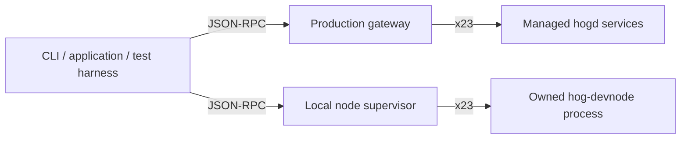

# Workspace architecture

This workspace connects contract developers and applications to Thruput.
It owns the public JSON-RPC interface and the off-chain development tools.
The `hogd` repository owns execution and chain state; the protocol repositories
own the binary wire definitions and their language bindings.

## One public API, two ways to serve it

The production gateway connects to independently managed backend services.
The local supervisor starts one `hog-devnode` process and connects to the
services it advertises. Both use the same public server implementation and
shared hogd response mapping. Local testing therefore exercises the public
interface without requiring a full validator deployment or a second RPC API.

The subprocess boundary keeps runtime state, auth, scheduling, and execution
with their owner in `hogd`. It avoids duplicating those semantics in Rust or
introducing a C ABI between the CLI and the runtime. The supervisor owns
startup, readiness, logs, and shutdown. See [runtime manifests](gateway/runtime-manifest.md)
for the handoff and [gateway design](gateway/system-design.md) for RPC behavior.

## The contract development path

The CLI scaffolds a Rust project, invokes its pinned toolchain, and lowers the
resulting ELF into an RV32 artifact. Contract interface metadata produces the
spec sidecar used for invocation and TypeScript binding generation. Deployment
and calls then use the public JSON-RPC interface, as applications do.

The separation matters: building a contract is offline and cannot decide
whether a particular chain will admit it. Signing identifies the network and
wallet; the runtime decides admission and execution. See [CLI design](cli/design.md)
and [RV32 design](rv32/design.md).

## Choosing a test tool

| Tool | Question it answers |
| --- | --- |
| `thruput test` | Does this project's contract pass executor-backed tests? |
| `thruput test --integration` | Does the project work through a real local node? |
| `thruput-testkit` | Do several application actors interact correctly? |
| `thruput-bench` | How does a specific RPC workload perform under controlled load? |

The [testkit design](testkit/DESIGN.md) explains its ownership and timing model.
Benchmark results describe the measured workload and environment, not general
network capacity.

## Where to read the code

| Concern | Start here |
| --- | --- |
| Method definitions and wire version | [json-rpc-api](../crates/json-rpc/json-rpc-api/src/lib.rs) |
| Payloads and errors | [json-rpc-types](../crates/json-rpc/json-rpc-types/src/lib.rs) |
| Shared public server | [json-rpc-server](../crates/json-rpc/json-rpc-server/src/native/service.rs) |
| Backend response mapping | [hogd-backend](../crates/x23/hogd-backend/src/lib.rs) |
| Production service wiring | [gateway](../crates/json-rpc/json-rpc-gateway/src/main.rs) |
| Local runtime lifecycle | [node-supervisor](../crates/node-supervisor/src/lib.rs) |
| CLI entrypoints | [CLI](../crates/cli/src/main.rs) |
| Embeddable invocation | [client](../crates/client/src/lib.rs) |
| Signing and wallet transactions | [signing](../crates/signing/src/lib.rs) |

[Cargo.toml](../Cargo.toml) lists the complete workspace. The
[OpenRPC artifact](../crates/json-rpc/open-rpc-spec/snapshots/thruput-spec.json)
is generated from the Rust API and payload types; it is the reference for
consumers integrating against the wire interface.
